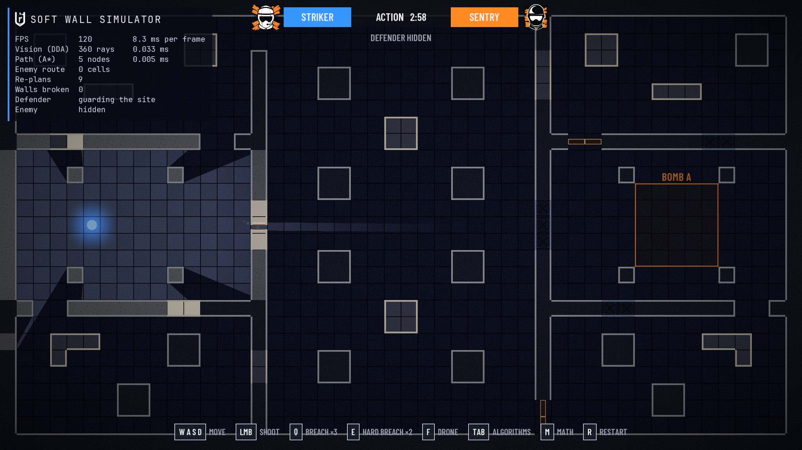
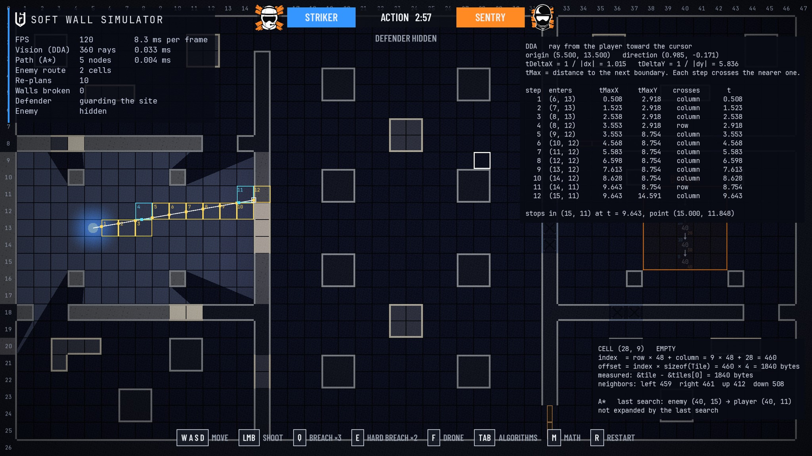

# Soft Wall Simulator

A 2D destruction and vision sandbox in C++17 and SFML 3, built without an engine and inspired by Rainbow Six Siege.
Shoot drywall to drill a sightline through it, or break it open.
The world reacts in the same frame.
360 DDA rays re-light the map through every hole.
An A\* defender re-plans its route through the breach before the next frame is drawn.
Press **M** to see the math behind all of it, with the real numbers the code computed.



## Highlights

- **Cache-friendly map.** The grid is one `std::vector<Tile>` in row-major order, 4 bytes per tile. A test measures real addresses to prove the layout.
- **DDA raycasting.** Every frame casts 360 rays with Amanatides–Woo grid traversal. Each ray visits exactly the cells it crosses and stops at the first wall.
- **Bullet holes you can see through.** A shot drills a slot through the drywall along the line of fire. Inside a holed wall, a second, finer DDA walks the wall's 4 × 4 panels, so rays pass through the slot. The sightline only works from where you shot, as in Siege.
- **The visibility polygon is the light.** The ray hits form a triangle fan. It is drawn into a light map with a radial gradient, and the light map is multiplied over the scene.
- **A\* pathfinding.** Moves go in 8 directions with integer costs of 10 and 14 and never cut a wall's corner. The search uses the octile heuristic, a binary heap, and flat per-cell arrays that are reused across searches.
- **Instant re-planning.** `World::damageTileAt` re-plans the defender's path inside the call that breaks the wall. A test proves it.
- **Siege look.** Soft walls are drywall over wooden studs, and hard walls are riveted steel. The attacker is blue, the defender is orange, and a shader adds drone-camera grain, scanlines, and a vignette.
- **Math view (M).** Every cell A\* expanded shows g, h, and f, with an arrow to its parent. The ray toward the cursor is traced step by step, with a table of tMaxX, tMaxY, tDeltaX, and tDeltaY. The hovered cell shows its index, its byte offset, and the octile formula worked with its own numbers. [docs/MATH.md](docs/MATH.md) derives every formula.
- **Algorithm view (Tab).** It shows the 360 rays, the polygon outline, the cells A\* expanded colored by expansion order, and the live path.
- **Headless tests.** The simulation layer contains no rendering code, so its 18 tests run without a window.

On an Intel Core Ultra 5 226V (Release build), the panel reports about 0.04 ms for the 360-ray cast.
An A\* search takes about 0.2 ms when it expands 656 cells at startup, and about 0.02 ms once a breach opens a straight route.




## Controls

| Input | Action |
|---|---|
| W A S D | Move |
| Left click | Shoot the wall under the cursor. Each hit on drywall drills a slot along your line of fire. The third hit breaks it. Steel never breaks. |
| Tab | Toggle the algorithm view |
| M | Toggle the math view. Point the cursor at anything to see its numbers. |

## Build and run

You need CMake 3.28 or newer, a C++17 compiler, and Git.
CMake downloads and builds SFML 3.0.2 during the first configure.

```
cmake -S . -B build
cmake --build build --config Release
build/bin/Release/SoftWallSimulator.exe
build/bin/Release/SoftWallTests.exe
```

Single-configuration generators such as Ninja put the programs in `build/bin/` instead.
The project was built and tested on Windows 11 with MSVC 19.29 (Visual Studio 2019 Build Tools).

## Architecture

The code has two layers.
`simulation/` holds the rules and links only `SFML::System`, for `sf::Vector2f`.
`presentation/` owns the window, input, and drawing, and reads the simulation through const references.

```
src/
  main.cpp                  Catches SimulatorError and prints its message.
  simulation/
    Grid                    Tile storage, bounds checks, damage, and the 4 x 4 panels of each soft wall.
    Level                   ASCII level parser and the 48 x 27 default map.
    Raycaster               DDA rays, the finer DDA through bullet holes, the 360-ray cast, line of sight, traces.
    Pathfinder              A* with buffers reused across searches; exposes g and parents for the math view.
    Player                  WASD movement with box collision, one axis at a time.
    Enemy                   Walks its path at constant speed.
    World                   Owns all of the above and decides when the enemy re-plans.
    SimulatorErrors.hpp     SimulatorError and the exceptions derived from it.
  presentation/
    Game                    Window, loop, input mapping, screen shake, draw order.
    TileMapRenderer         Floor, drywall, and steel in vertex arrays; hit flashes.
    LightingRenderer        Turns the visibility polygon into a light map.
    DroneCameraFilter       Grain, scanlines, and vignette in a fragment shader.
    ParticleSystem          Fixed-capacity pool for plaster dust, splinters, and sparks.
    AlgorithmOverlay        The Tab view.
    MathView                The M view.
    TextBatch               Draws hundreds of labels in one draw call.
    StatisticsPanel         Live numbers.
    HeadsUpDisplay          Attacker and defender banner, key prompts.
tests/
  SimulationTests.cpp       Framework-free tests that print PASS or FAIL.
docs/
  MATH.md                   Derivations of every formula, with worked examples.
```

Each frame runs in this order:

1. Handle events. A click calls `World::damageTileAt`, which drills a slot and re-plans when a wall breaks.
2. Update the world: move the player, re-plan if the player entered a new cell, walk the enemy, cast 360 rays.
3. Draw the floor, the dust and splinters, and the wall bodies into the scene texture.
4. Multiply the light map over them.
5. Draw what must stay visible in the dark: wall outlines, flashes, the algorithm view, the enemy (when in sight), the player, and sparks.
6. Copy the scene to the window through the drone-camera shader.
7. Draw the math view, the statistics panel, and the banner on top, where the shader cannot blur them.

## How it works

The short version is below. [docs/MATH.md](docs/MATH.md) has the derivations and worked examples.

### The grid

Cell `(column, row)` lives at index `row * 48 + column`, and its bytes start at `index * sizeof(Tile)`.
Every loop over the map walks rows on the outside and columns on the inside, which matches the memory order.
Cells outside the map count as walls for vision, so every ray is guaranteed to stop.

### DDA raycasting

A ray tracks two distances: to the next column boundary (tMaxX) and to the next row boundary (tMaxY).
Each step crosses whichever boundary is nearer and enters the cell behind it.
A step is one comparison, one addition, and one tile lookup, with no trigonometry.
The 360 ray directions are computed once, when the `Raycaster` is constructed.

### Bullet holes

Each soft wall stores 16 panels as bits of a `uint16_t`.
A mostly horizontal shot clears the row of panels at the height it hit, and a mostly vertical one clears a column.
When a ray enters a wall with holes, the same DDA runs again at a quarter of the cell size.
If the ray leaves the tile before meeting an intact panel, it went through the slot and keeps going.

### Light from the visibility polygon

The 360 hit points, in angle order, form a triangle fan around the player.
Each vertex gets texture coordinates into a radial gradient centered on the player, so brightness falls off with true distance.
The fan is added on top of a dim ambient color in a render texture, and that light map is multiplied over the floor and walls.

### A\*

The open set is a binary heap in a member `std::vector`, kept with `std::push_heap` and `std::pop_heap`.
The octile heuristic is consistent, so the first time a cell leaves the heap, its cost is final; later copies are skipped.
On equal estimates, the heap prefers the entry closer to the goal, which keeps the search heading forward.
A diagonal step is allowed only when both cells beside it are open, so the enemy never clips a corner.

### Destruction

A click maps from pixel to world through the same view the frame was drawn with, so it stays accurate during screen shake.
`std::floor`, not a cast, maps world to cell, so a click left of the map never lands in column 0.
Each hit takes one health and drills a slot. At zero health the tile becomes empty, and the world re-plans the enemy's path before `damageTileAt` returns.

## Tests

```
Soft Wall Simulator - simulation tests

PASS  Grid stores cells in row-major order in one vector
PASS  A click position maps to the cell under it
PASS  Clicking a soft wall reduces its health by one
PASS  A soft wall becomes EMPTY at zero health
PASS  Vision casts exactly 360 rays
PASS  A ray stops at the first non-EMPTY tile
PASS  A* finds the shortest path around a wall
PASS  Destroying a wall recalculates the enemy path within the same call
PASS  End to end: breaking a soft wall opens a shortcut, and the enemy walks through it
PASS  End to end: breaking the wall between player and enemy gives line of sight
PASS  A shot opens a hole that vision passes through
PASS  End to end: a bullet hole shows the enemy through a wall that still stands
PASS  End to end: a bullet hole gives sight only along the line of fire
PASS  The DDA trace records tMaxX, tMaxY, and the axis of every step
PASS  A* keeps g and the parent of every expanded cell
PASS  Tiles sit contiguously: cell (12, 7) is 1392 bytes after cell (0, 0)
PASS  End to end: the DDA trace agrees with line of sight, before and after a bullet hole
PASS  End to end: along the enemy's route, each step adds its own cost to g

18 passed, 0 failed
```

The test program exits with code 1 if any test fails.
The DDA and A\* tests check numbers worked out by hand in [docs/MATH.md](docs/MATH.md).

## Engineering choices

- **Warnings are errors.** Project targets build at `/W4 /permissive-` on MSVC and `-Wall -Wextra -Wpedantic` elsewhere. SFML is included as a system dependency, so its headers do not trip these warnings.
- **No manual memory management.** There is no `new` or `delete`. Containers and SFML objects own every resource. Classes whose texts point at a member font delete their copy operations.
- **Buffers are reused in hot paths.** Rays, the light map, particles, and the algorithm view keep their buffers between frames. A\* reuses its per-cell arrays, so only the returned path allocates.
- **Batched drawing.** Each layer of the map is one vertex array. `TextBatch` packs labels into one vertex array over the font's glyph texture, so the roughly 2,000 A\* numbers cost two draw calls, one per text size, instead of one per label.
- **Errors are specific.** `GridBoundsError`, `LevelFormatError`, and `ResourceError` derive from `SimulatorError`, and each carries a message that names the problem.
- **The code favors plain reading.** Types are written out instead of `auto`, loops are explicit, and names are full words.

## Credits

- [SFML 3.0.2](https://www.sfml-dev.org/) under the zlib license, downloaded at configure time.
- [JetBrains Mono](https://www.jetbrains.com/lp/mono/) and [Barlow Condensed](https://github.com/jpt/barlow) under the SIL Open Font License 1.1. The fonts and their licenses are in `assets/fonts/`.
- Inspired by Rainbow Six Siege. This project is not affiliated with or endorsed by Ubisoft.
