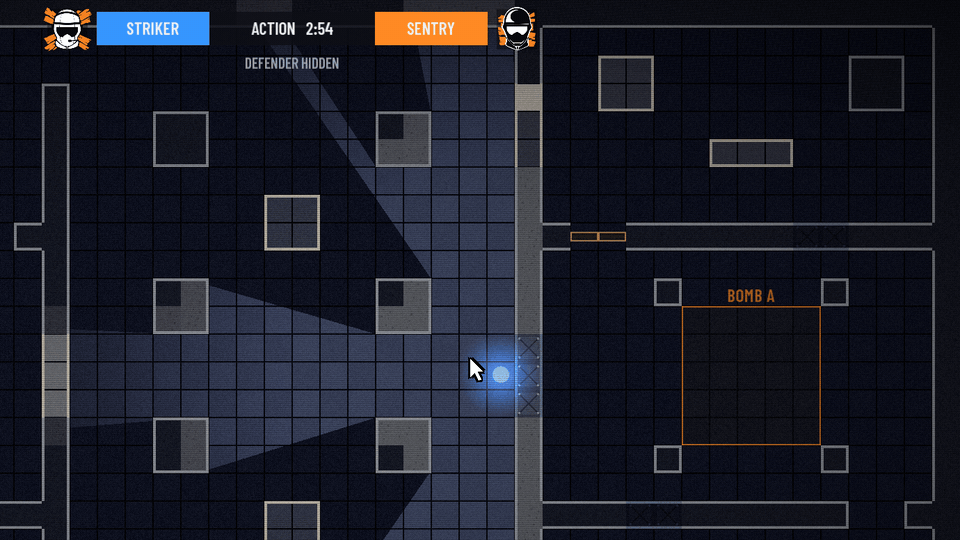
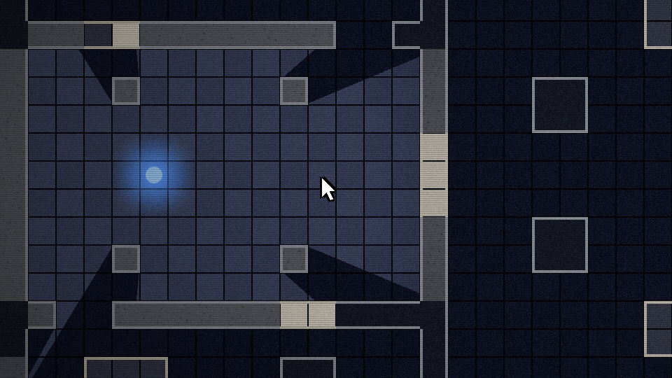
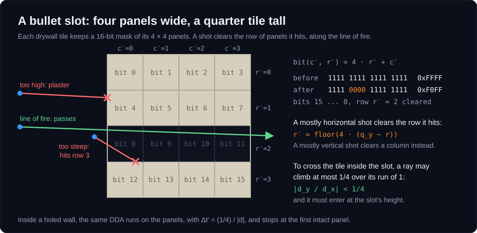
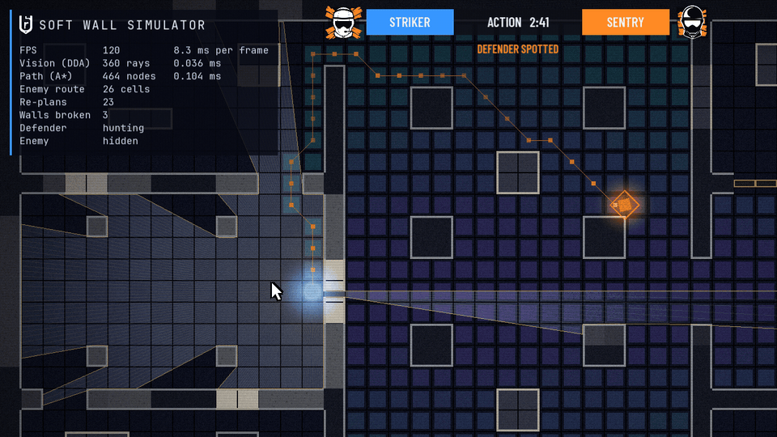
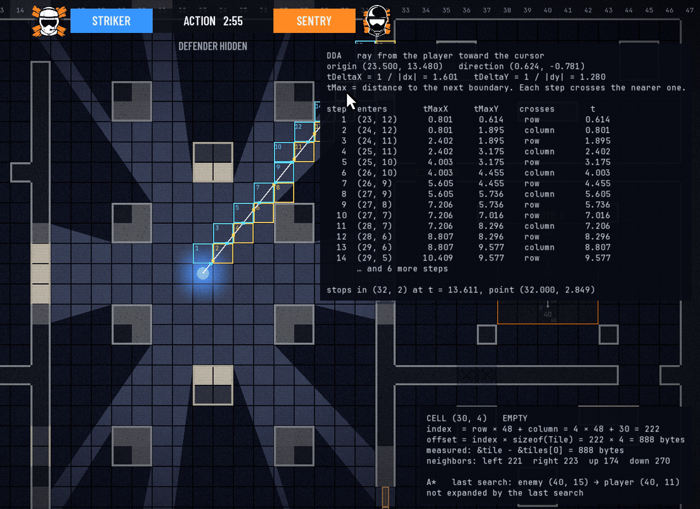
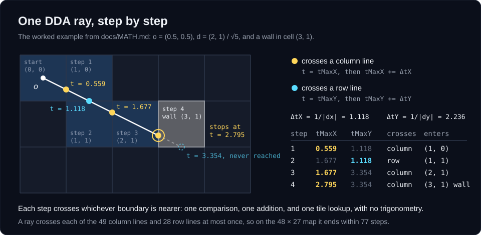
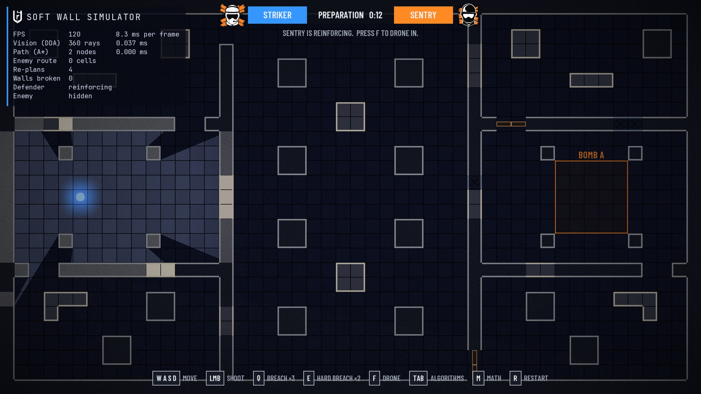
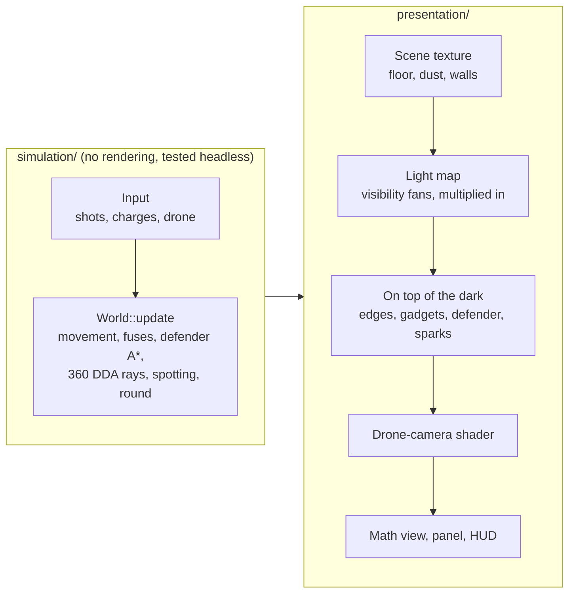
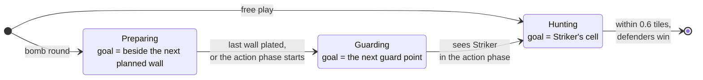

# Soft Wall Simulator

[](../../actions/workflows/ci.yml)

A 2D, top-down round of Rainbow Six Siege's bomb mode in C++17 and SFML 3, built without an engine.
You play Striker, the attacker. An AI Sentry defends bomb site A.
During preparation, Sentry reinforces walls with steel while you drone the building.
In the action phase you open a route with bullets, breach charges, and hard breach charges, then plant the defuser.
Underneath, 360 DDA rays light the map through every hole, and Sentry's A\* path re-plans the instant a wall breaks.
Press **M** to see the math behind all of it, with the real numbers the code computed.



## Inspiration

In Rainbow Six Siege, walls are information.
A bullet hole in drywall opens a sightline.
A breach charge changes every route through the building, and a reinforced wall closes both.
Defenders shape the map during preparation, and attackers tear it open during the action phase.
Siege builds this on RealBlast, its procedural destruction engine ([GDC 2016 talk](https://www.gdcvault.com/play/1023003/The-Art-of-Destruction-in)).

This project asks a smaller question: what does it take to keep vision and pathfinding correct when any wall can change on any frame?

| In Siege | Here | Under the hood |
|---|---|---|
| Shooting drywall opens a sightline | A shot clears a slot in the wall's 4 × 4 panels, along the line of fire | A second DDA walks the panels inside a holed wall |
| Defenders reinforce walls during preparation | Sentry walks to each planned wall and turns it to steel | A\* to the closest open side of the wall |
| Hard breachers burn through reinforced walls | A hard breach charge burns for 3 seconds, then opens steel | One blast, then one A\* re-plan |
| Breach charges blow open drywall and barricades | A breach charge opens its wall and the drywall and barricades beside it | The blast is filtered by tile type |
| The drone phase | A drone with its own 360 rays rolls under barricades | A second visibility polygon and a spotting timer |
| A roaming defender | Sentry reinforces, guards the site, then hunts you | One A\*, three goals |
| The drone camera feed | Grain, scanlines, and a vignette | A GLSL fragment shader |

The papers and talks behind the algorithms are under [References](#references).

## See it work

### A bullet hole is a sightline



Each shot drills a slot through the drywall along the line of fire.
Inside a holed wall, a second DDA walks the wall's 4 × 4 panels, so light and sight pass only through the slot.
The third hit on the same wall breaks it.



### Breaking a wall re-plans the defender in the same frame



The algorithm view (Tab) shows the 360 rays, the cells A\* expanded, and the defender's path.
Sentry spotted Striker through a bullet slot and is hunting along the only walkable route, around the north of the hall.
When the breach charge opens the wall, `World::burnFuses` re-runs A\* once for the whole blast, and the path cuts straight through the hole in the same frame.

### The math view



Press M. The ray from Striker toward the cursor is traced cell by cell, with tMaxX and tMaxY at every crossing.
The hovered cell shows its index and byte offset, measured from real addresses.

## The math in 60 seconds

Four formulas carry the project.
[docs/MATH.md](docs/MATH.md) derives each one and works an example by hand, and the tests check those examples.

**1. The map is one array.** Cell $(c, r)$ of the $48 \times 27$ grid lives at

$$
\text{index} = r \cdot 48 + c, \qquad \text{offset} = 4 \cdot \text{index} \text{ bytes}.
$$

Left and right neighbors sit side by side in memory, so loops that walk row by row read memory front to back.
[The derivation.](docs/MATH.md#1-the-grid-a-2d-map-in-one-array)

**2. A ray steps from cell to cell.** Crossing one column costs $\Delta t_x = 1/|d_x|$ of distance along the ray, and crossing one row costs $\Delta t_y = 1/|d_y|$. Each step crosses whichever boundary is nearer:

$$
\text{if } t^{\max}_x < t^{\max}_y:\; t^{\max}_x \mathrel{+}= \Delta t_x, \qquad \text{else}:\; t^{\max}_y \mathrel{+}= \Delta t_y.
$$

That is one comparison and one addition per cell, with no trigonometry, and a ray ends within $W + H + 2$ steps.
[The derivation.](docs/MATH.md#2-dda-walking-a-ray-through-the-grid)



**3. A\* with an exact estimate.** $f = g + h$, where a straight step costs 10, a diagonal step costs 14, and $h$ is the octile distance:

$$
h = 14 \min(\Delta c, \Delta r) + 10 \big(\max(\Delta c, \Delta r) - \min(\Delta c, \Delta r)\big).
$$

It never overestimates, and it never drops by more than one step's cost, so the first time A\* pops a cell, that cell's cost is final.
[The derivation.](docs/MATH.md#5-a-g-h-and-f)

**4. Light falls off smoothly.** Brightness at distance $\rho$ from a light of radius $R$ is

$$
b(\rho) = 1 - \operatorname{smoothstep}\!\left(\frac{\rho}{R}\right), \qquad \operatorname{smoothstep}(x) = 3x^2 - 2x^3.
$$

Texture coordinates are an affine function of position, so the GPU's linear interpolation keeps the falloff exactly radial inside every triangle of the fan.
[The derivation.](docs/MATH.md#4-light-from-the-visibility-polygon)

## How a round plays

1. **Preparation, 0:20.** Sentry walks to each planned wall and reinforces it. You wait at spawn. Press F to drive a drone; it rolls under barricades, and whatever it sees is spotted, marked in orange through walls.
2. **Action, 3:00.** Open a way in:
   - Shoot drywall to drill a slot you can see through, or break it with three hits.
   - Break a barricade with one shot.
   - Stick a breach charge (Q) on drywall or a barricade to blow it open, along with its drywall neighbors.
   - Stick a hard breach charge (E) on reinforced steel to burn through it.
3. **The defender.** The AI Sentry guards the site until it sees you. Then it hunts you, re-planning its route through every new hole the moment the hole opens.
4. **The end.** Stand inside bomb site A for 4 seconds to plant the defuser and win. If Sentry reaches you, or the clock runs out, the defenders win. Press R for the next round.



## Highlights

- **Cache-friendly map.** The grid is one `std::vector<Tile>` in row-major order, 4 bytes per tile, with five tile types: empty, drywall, concrete, reinforced steel, and barricade. A test measures real addresses to prove the layout.
- **DDA raycasting.** Every frame casts 360 rays from you, and 360 more from the drone while you drive it, with Amanatides–Woo grid traversal. Each ray visits exactly the cells it crosses and stops at the first wall.
- **Bullet holes you can see through.** A shot drills a slot through drywall along the line of fire. Inside a holed wall, a second, finer DDA walks the wall's 4 × 4 panels, so rays pass through the slot. The sightline only works from where you shot.
- **The visibility polygon is the light.** Each light's ray hits form a triangle fan. The fans are added into a light map with a radial gradient, and the light map is multiplied over the scene.
- **A\* pathfinding.** Moves go in 8 directions with integer costs of 10 and 14 and never cut a wall's corner. The search uses the octile heuristic, a binary heap, and flat per-cell arrays that are reused across searches.
- **A defender with goals.** A small state machine (preparing, guarding, hunting) gives A\* different goals: the floor beside the next wall to reinforce, the site's guard points, then you. Every tile change re-plans the current goal in the same call.
- **Siege rules.** Reinforcement, breach and hard breach charges with fuses, barricades, a drone, spotting, a bomb site, and a round clock with preparation and action phases.
- **Siege look.** Drywall over wooden studs, concrete, braced steel plates, and plank barricades. The attacker is blue and the defender orange, and a shader adds drone-camera grain, scanlines, and a vignette. The banner and the result screen show the official Striker and Sentry operator icons, and the Rainbow Six emblem heads the panel. The art comes from Ubisoft's official fan kits.
- **Math view (M).** Every cell A\* expanded shows g, h, and f, with an arrow to its parent. The ray toward the cursor is traced step by step, with a table of tMaxX, tMaxY, tDeltaX, and tDeltaY. The hovered cell shows its index, its byte offset, and the octile formula worked with its own numbers. [docs/MATH.md](docs/MATH.md) derives every formula.
- **Algorithm view (Tab).** It shows the 360 rays, the polygon outline, the cells A\* expanded colored by expansion order, and the defender's live path.
- **Headless tests.** The simulation layer contains no rendering code, so its 32 tests run without a window, including two full rounds.

On an Intel Core Ultra 5 226V (Release build), the panel reports about 0.04 ms for the 360-ray cast.
The longest A\* search measured, 656 cells across the whole map, took about 0.2 ms. The defender's short moves around the site take about 0.01 ms.

## Where to look in the code

| Idea | Where |
|---|---|
| The tile layout and its bounds checks | `Tile` and `Grid::indexOf` in [Grid.hpp](src/simulation/Grid.hpp) and [Grid.cpp](src/simulation/Grid.cpp) |
| The DDA ray, and the second DDA through bullet holes | `Raycaster::castRay` and `Raycaster::findStopDistance` in [Raycaster.cpp](src/simulation/Raycaster.cpp) |
| A\* with a binary heap and reused buffers | `Pathfinder::findPath` in [Pathfinder.cpp](src/simulation/Pathfinder.cpp) |
| Re-planning inside the shot that broke the wall | `World::damageTileAt` in [World.cpp](src/simulation/World.cpp) |
| The defender's state machine | `World::updateDefender` in [World.cpp](src/simulation/World.cpp) |
| The visibility polygon as light | `LightingRenderer::addLight` in [LightingRenderer.cpp](src/presentation/LightingRenderer.cpp) |
| The drone-camera shader | [DroneCameraFilter.cpp](src/presentation/DroneCameraFilter.cpp) |
| The tests, including two full rounds | [SimulationTests.cpp](tests/SimulationTests.cpp) |

## Controls

| Input | Action |
|---|---|
| W A S D | Move. While the drone is active, drive it instead. |
| Left click | Shoot the wall under the cursor. Each hit on drywall drills a slot along your line of fire, and the third hit breaks it. One hit breaks a barricade. Concrete and steel never break. |
| Q | Breach charge on the wall under the cursor. You carry 3. The wall must touch your cell. |
| E | Hard breach charge on the wall under the cursor. You carry 2. Only this opens reinforced steel. |
| F | Deploy the drone, or switch between it and Striker. |
| Tab | Toggle the algorithm view. |
| M | Toggle the math view. Point the cursor at anything to see its numbers. |
| R | Start the round over. |

## Build and run

You need CMake 3.28 or newer, a C++17 compiler, and Git.
CMake downloads and builds SFML 3.0.2 during the first configure.

```
cmake -S . -B build
cmake --build build --config Release
build/bin/Release/SoftWallSimulator.exe
build/bin/Release/SoftWallTests.exe
```

Single-configuration generators such as Ninja put the programs in `build/bin/` instead.
The project was built and tested on Windows 11 with MSVC 19.29 (Visual Studio 2019 Build Tools).
On every push, [GitHub Actions](.github/workflows/ci.yml) builds it with the same compiler on the `windows-2022` runner and runs the tests.

## Architecture

The code has two layers.
`simulation/` holds the rules and links only `SFML::System`, for `sf::Vector2f`.
`presentation/` owns the window, input, and drawing, and reads the simulation through const references.

```
src/
  main.cpp                  Catches SimulatorError and prints its message.
  simulation/
    Grid                    Tile storage, bounds checks, damage, reinforcement, and the 4 x 4 panels of each soft wall.
    Level                   ASCII level parser and the 48 x 27 default map, with its planned reinforcements and bomb site.
    Raycaster               DDA rays, the finer DDA through bullet holes, the 360-ray cast, line of sight, traces.
    Pathfinder              A* with buffers reused across searches; exposes g and parents for the math view.
    Player, Drone           Movement with box collision, one axis at a time. The drone rolls under barricades.
    Enemy                   Walks its path at constant speed.
    Round                   The clock, the phases, planting, and who won.
    World                   Owns all of the above: charges, spotting, and the defender's state machine.
    SimulatorErrors.hpp     SimulatorError and the exceptions derived from it.
  presentation/
    Game                    Window, loop, input mapping, explosion effects, screen shake, draw order.
    TileMapRenderer         Floor, drywall, concrete, steel, barricades, and the bomb site in vertex arrays.
    LightingRenderer        Turns visibility polygons into a light map.
    GadgetRenderer          Charges and their fuses, the drone, the spotted mark, the site label.
    DroneCameraFilter       Grain, scanlines, and vignette in a fragment shader.
    ParticleSystem          Fixed-capacity pool for dust, splinters, and sparks.
    AlgorithmOverlay        The Tab view.
    MathView                The M view.
    TextBatch               Draws hundreds of labels in one draw call.
    StatisticsPanel         Live numbers.
    HeadsUpDisplay          Operator banner with the operator icons, round clock, status, results, key prompts.
tests/
  SimulationTests.cpp       Framework-free tests that print PASS or FAIL.
docs/
  MATH.md                   Derivations of every formula, with worked examples.
.github/workflows/
  ci.yml                    Builds the project and runs the tests on every push.
```



Each frame runs in this order:

1. Handle events. A click calls `World::damageTileAt`; Q and E call `World::placeCharge`.
2. Update the world: move Striker or the drone, burn the fuses, run the defender, cast the rays, update spotting and the round.
3. Rebuild the wall vertices if any tile changed, and start the effects for detonations and reinforcements.
4. Draw the floor, the dust and splinters, and the wall bodies into the scene texture, then multiply the light map over them.
5. Draw what must stay visible in the dark: outlines, the bomb site, flashes, gadgets, the defender (when in sight), Striker, and sparks.
6. Copy the scene to the window through the drone-camera shader.
7. Draw the math view, the statistics panel, and the banner on top, where the shader cannot blur them.

## How it works

The short version is below. [docs/MATH.md](docs/MATH.md) has the derivations and worked examples.

### The grid

Cell `(column, row)` lives at index `row * 48 + column`, and its bytes start at `index * sizeof(Tile)`.
Every loop over the map walks rows on the outside and columns on the inside, which matches the memory order.
Cells outside the map count as walls for vision, so every ray is guaranteed to stop.

### DDA raycasting

A ray tracks two distances: to the next column boundary (tMaxX) and to the next row boundary (tMaxY).
Each step crosses whichever boundary is nearer and enters the cell behind it.
A step is one comparison, one addition, and one tile lookup, with no trigonometry.
The 360 ray directions are computed once, when the `Raycaster` is constructed.

### Bullet holes

Each soft wall stores 16 panels as bits of a `uint16_t`.
A mostly horizontal shot clears the row of panels at the height it hit, and a mostly vertical one clears a column.
When a ray enters a wall with holes, the same DDA runs again at a quarter of the cell size.
If the ray leaves the tile before meeting an intact panel, it went through the slot and keeps going.
Reinforcing a wall covers its holes with steel.

### Light from the visibility polygons

The 360 hit points, in angle order, form a triangle fan around each light.
Each vertex gets texture coordinates into a radial gradient centered on its light, so brightness falls off with true distance.
The fans are added on top of a dim ambient color in a render texture, and that light map is multiplied over the floor and walls.

### A\*

The open set is a binary heap in a member `std::vector`, kept with `std::push_heap` and `std::pop_heap`.
The octile heuristic is consistent, so the first time a cell leaves the heap, its cost is final; later copies are skipped.
On equal estimates, the heap prefers the entry closer to the goal, which keeps the search heading forward.
A diagonal step is allowed only when both cells beside it are open, so the enemy never clips a corner.

### The round and the defender

`Round` is a clock with phases: preparation, action, and the two endings.
Standing in the bomb site during the action phase fills the plant. Stepping out starts it over.
The defender is a state machine that only changes A\*'s goal:

- **Preparing.** For each planned wall, the defender searches to every open side and walks to the closest. It stands there for 1.2 seconds, and the wall turns to steel.
- **Guarding.** It walks between the site's guard points and pauses at each.
- **Hunting.** The moment it has line of sight to Striker during the action phase, it chases. It re-plans whenever Striker changes cell or any tile changes, and it wins the round on contact.



### Destruction and charges

A click maps from pixel to world through the same view the frame was drawn with, so it stays accurate during screen shake.
`std::floor`, not a cast, maps world to cell, so a click left of the map never lands in column 0.
A charge goes on a wall that touches Striker's cell and burns down its fuse: 1.5 seconds for a breach charge, 3 for a hard breach charge.
It then opens its wall and every neighbor, up, down, left, and right, that the same charge could open.
Every tile it opens is reported once, and the defender re-plans once for the whole blast.

## Tests

```
Soft Wall Simulator - simulation tests

PASS  Grid stores cells in row-major order in one vector
PASS  A click position maps to the cell under it
PASS  Clicking a soft wall reduces its health by one
PASS  A soft wall becomes EMPTY at zero health
PASS  Vision casts exactly 360 rays
PASS  A ray stops at the first non-EMPTY tile
PASS  A* finds the shortest path around a wall
PASS  Destroying a wall recalculates the enemy path within the same call
PASS  End to end: breaking a soft wall opens a shortcut, and the enemy walks through it
PASS  End to end: breaking the wall between player and enemy gives line of sight
PASS  A shot opens a hole that vision passes through
PASS  End to end: a bullet hole shows the enemy through a wall that still stands
PASS  End to end: a bullet hole gives sight only along the line of fire
PASS  The DDA trace records tMaxX, tMaxY, and the axis of every step
PASS  A* keeps g and the parent of every expanded cell
PASS  Tiles sit contiguously: cell (12, 7) is 1392 bytes after cell (0, 0)
PASS  End to end: the DDA trace agrees with line of sight, before and after a bullet hole
PASS  End to end: along the enemy's route, each step adds its own cost to g
PASS  Reinforcing turns drywall into steel that blocks walking and vision
PASS  Bullets cannot open a reinforced wall
PASS  A hard breach charge burns through a reinforced wall after its 3-second fuse
PASS  A breach charge opens a soft wall and its soft neighbors, but not steel
PASS  A barricade blocks the doorway and breaks in one shot
PASS  The drone is faster than the attacker and casts its own 360 rays
PASS  What the drone sees is spotted, and the mark fades after 4 seconds
PASS  Holding the bomb site for 4 seconds plants the defuser and wins
PASS  The defender reinforces its planned walls during preparation
PASS  When the action phase runs out, the defenders win
PASS  When the defender reaches the attacker, the defenders win
PASS  The defender guards the site until it spots the attacker, then hunts
PASS  End to end: the defender reinforces, the attacker hard-breaches, and the defender hunts through the breach
PASS  End to end: the attacker breaks a barricade, holds the site, and wins

32 passed, 0 failed
```

The test program exits with code 1 if any test fails.
The DDA and A\* tests check numbers worked out by hand in [docs/MATH.md](docs/MATH.md).
Levels without a bomb site run in free play: no clock, and the defender hunts from the first frame. The early tests use such levels.

## Engineering choices

- **Warnings are errors.** Project targets build at `/W4 /permissive-` on MSVC and `-Wall -Wextra -Wpedantic` elsewhere. SFML is included as a system dependency, so its headers do not trip these warnings.
- **No manual memory management.** There is no `new` or `delete`. Containers and SFML objects own every resource. Classes whose texts or sprites point at a member font or texture delete their copy operations.
- **Buffers are reused in hot paths.** Rays, the light map, particles, and the algorithm view keep their buffers between frames. A\* reuses its per-cell arrays, so only the returned path allocates.
- **Batched drawing.** Each layer of the map is one vertex array. `TextBatch` packs labels into one vertex array over the font's glyph texture, so hundreds of A\* numbers cost two draw calls, one per text size, instead of one per label.
- **One revision counter.** The grid counts every tile change, so the renderer rebuilds walls once per frame no matter what changed them: a shot, a charge, or a reinforcement.
- **Errors are specific.** `GridBoundsError`, `LevelFormatError`, and `ResourceError` derive from `SimulatorError`, and each carries a message that names the problem.
- **The code favors plain reading.** Types are written out instead of `auto`, loops are explicit, and names are full words.

## References

- John Amanatides and Andrew Woo, [*A Fast Voxel Traversal Algorithm for Ray Tracing*](https://www.eecs.yorku.ca/~amana/research/grid.pdf), Eurographics 1987. The DDA in `Raycaster`.
- Peter E. Hart, Nils J. Nilsson, and Bertram Raphael, [*A Formal Basis for the Heuristic Determination of Minimum Cost Paths*](https://doi.org/10.1109/TSSC.1968.300136), IEEE Transactions on Systems Science and Cybernetics, 1968. The paper that introduced A\*.
- Amit Patel, Red Blob Games: [*Introduction to the A\* Algorithm*](https://www.redblobgames.com/pathfinding/a-star/introduction.html), [*Heuristics*](http://theory.stanford.edu/~amitp/GameProgramming/Heuristics.html) for the octile distance, and [*2D Visibility*](https://www.redblobgames.com/articles/visibility/).
- Lode Vandevenne, [*Raycasting*](https://lodev.org/cgtutor/raycasting.html). DDA in a Wolfenstein-style raycaster.
- Squirrel Eiserloh, [*Math for Game Programmers: Juicing Your Cameras With Math*](https://www.gdcvault.com/play/1023557/Math-for-Game-Programmers-Juicing), GDC 2016. Trauma-based screen shake.
- Julien L'Heureux, [*The Art of Destruction in Rainbow Six: Siege*](https://www.gdcvault.com/play/1023003/The-Art-of-Destruction-in), GDC 2016. How RealBlast made destruction a core part of Siege.

## Credits

- [SFML 3.0.2](https://www.sfml-dev.org/) under the zlib license, downloaded at configure time.
- [JetBrains Mono](https://www.jetbrains.com/lp/mono/) and [Barlow Condensed](https://github.com/jpt/barlow) under the SIL Open Font License 1.1. The fonts and their licenses are in `assets/fonts/`.
- The Striker and Sentry operator icons and the Rainbow Six Siege emblem in `assets/siege/` come from Ubisoft's official Rainbow Six Siege fan kits. `assets/siege/CREDITS.txt` names the kit each file came from.
- Rainbow Six Siege, its logos, its operators, and the gadget names are trademarks of Ubisoft Entertainment. This is a non-commercial fan project. It is not affiliated with, sponsored by, or endorsed by Ubisoft.
